<p align="center">
  
</p>

> **`su66uu` is `subbu`, translated for the terminal.**

My preferred interface is a prompt. I learned Vim, moved completely to
Neovim, and now feel most at home in a terminal. Away from the keyboard, you
will usually find me playing or following cricket. Back at it, I am currently
going deeper into systems and how their pieces fit together.

```vim
:set editor=neovim
:set playground=cricket
:set learning=systems-design
:set status=curious
```

### `~/projects`

| shortcut | opens |
|---|---|
| [`git first`](https://github.com/su66uu/FirstCommit) | **FirstCommit** — see a repository's first commit in a terminal-style browser extension. |
| [`pulse scan`](https://github.com/su66uu/pulse) | **Pulse** — follow code health, complexity, churn, and hotspots over time. |
| [`drift`](https://github.com/su66uu/drift) | **Drift** — trade an endless feed for one fascinating technical problem. |
| [`snap --youtube`](https://github.com/su66uu/snap) | **And I Snap!** — a local-first experiment in taking attention back from YouTube. |

<p align="center">
  <a href="https://su66u.com">website</a>
  &nbsp;·&nbsp;
  <a href="https://www.linkedin.com/in/venkata-subbarao-myla-b45b14135/">linkedin</a>
  &nbsp;·&nbsp;
  <a href="https://github.com/su66uu?tab=repositories">repositories</a>
</p>

<p align="center"><sub><code>:w</code> keeps the work · curiosity keeps me here</sub></p>
